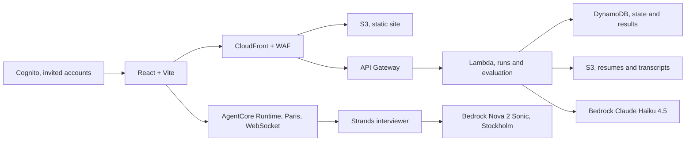

# AWS SA Interview Simulator — v1 specification

**Status: agreed product and technical decisions, 13 November 2026.** This document specifies the first increment. Later interview rounds are described at the end.

## 1. Product, language, and process fidelity

The product prepares candidates for **AWS Solutions Architect interviews in France**. It serves as a personal training tool and demonstrates its creator's engineering skills through the project. The application is private: only accounts explicitly invited by the administrator can use it. There is no public sign-up and no public access to a user's résumé, interviews, or results.

**Language rule:** engineering discussions, code, technical documentation, and CI output use English. The application interface and default interviews use **French**. Interviewer prompts, scenario content, coaching, evaluation explanations, errors shown in the UI, and accessibility text must be French in v1. An English interview round can be added when the extended process calls for one. Internal API identifiers and database fields remain in English. This keeps the working language separate from the candidate experience.

A **run** represents one full simulation. It contains a journey configuration, a mode, and ordered rounds. Each round can have multiple **attempts**, all of which remain available in the run history. V1 delivers a run with **one complete voice round**. Additional rounds will extend the journey incrementally.

Amazon publicly describes a general hiring process that can include a phone screen and an interview loop, while stating that the process varies by role. There is no published, unique “AWS SA France” sequence. The product aims to follow the best available evidence: each journey step records its source, verification date, and status as `confirmed` or `variable/assumed`. The default journey uses a common path; variable steps can be enabled or removed when full journey configuration is implemented. The app must not claim to know internal questions, the real AWS verdict, or a universally fixed number of rounds. [Amazon hiring process](https://www.amazon.jobs/content/en/how-we-hire), [interview loop](https://amazon.jobs/content/en/how-we-hire/interview-loop), [AWS interview advice](https://aws.amazon.com/careers/life-at-aws-recruiters-share-10-ways-to-excel-in-your-aws-in-person-interview/).

The first round is a **20-minute recruiter conversation in French**. It explores the candidate's background, motivation for AWS and the SA role, and ability to support claims with concrete experience. The interviewer may follow up on certifications, projects, and personal contributions. It is not a deep architecture interview. Later rounds may cover technical screening, Leadership Principles, customer discovery, architecture, technical presentation, and a final loop where supported by sources. An English round becomes an optional journey variant when the full process is added.

## 2. V1 candidate journey

1. The administrator invites an account. The candidate signs in.
2. The candidate uploads a PDF or DOCX résumé. The app extracts its text, shows a preview, and lets the candidate correct the text that the interviewer will use. An empty, unreadable, or scanned document without extractable text produces an actionable error. V1 does not perform OCR.
3. The candidate creates a run in `learning` or `exam` mode. The v1 journey profile contains only the recruiter round. Mode and journey version are fixed for that run.
4. The candidate starts an attempt. The UI requests microphone access, shows connection status and finalized transcript entries, and provides microphone mute and end-interview controls.
5. The interviewer conducts the conversation. It covers the round's objectives while following up on actual answers. The candidate may ask questions, correct an answer, or interrupt the interviewer. The agent tracks what was actually spoken.
6. On completion, the app finalizes the transcript and evaluates the attempt outside the voice stream. The UI shows an evaluation-in-progress state until the result is available.
7. The candidate views the result, can request further coaching in learning mode, and can finish or retry the round. Previous attempts remain in the run history.

### Recruiter round behavior

The interviewer opens the conversation, explores the background and one or two relevant accomplishments, asks why AWS and why Solutions Architect, probes at least one real experience, allows candidate questions, and closes. An indicative time allocation is 2/5/4/5/3/1 minutes. It must not force a topic change in the middle of an answer. Follow-ups establish what **the candidate personally did**, which decisions were made, what outcomes are known, and what they would improve. The agent must not invent experience or metrics from the résumé. It must not recite the scoring rubric during the interview.

At 20 minutes, the UI indicates that the interview is ending and lets the current answer conclude before finalizing the attempt. A candidate-ended attempt is evaluated only when there is enough conversation to assess; otherwise it is marked `incomplete`. Denied microphone access or connection failure does not open a live attempt and shows a recovery action.

### Modes

| Moment | Learning | Blind exam |
| --- | --- | --- |
| Before the round | Objectives, expectations, and preparation advice are visible. | Only the round introduction, duration, and practical instructions are shown. |
| During the round | Natural conversation without unsolicited corrections. | The same conversation without hints or rubric. |
| After the round | Rubric, evidence, strengths, improvements, and coaching; additional coach questions on request. | Verdict and short reason first; detailed rationale expandable afterward, then finish or retry in v1. |

V1 has no next round, so it offers `finish` or `retry` and does not promise an unavailable interview. In later multi-round versions, `continue` advances even after a negative verdict; `retry` creates a new attempt **inside the same run**. An attempt never overwrites an earlier one. The latest completed verdict determines the round's current state; the history shows every verdict.

## 3. Evaluation and coaching

An evaluator separate from the interviewer reads only the confirmed résumé snapshot captured at attempt start, that attempt's **final** transcript, and the versioned rubric. Speculative text fragments and interrupted audio that was never played are not evidence. Claude Haiku 4.5 on Bedrock is the selected model; its evaluation prompt is versioned in Bedrock Prompt Management. Nova 2 Sonic voice instructions and scenarios are versioned in the repository because Prompt Management does not directly support this model. [Nova 2 Sonic model card](https://docs.aws.amazon.com/bedrock/latest/userguide/model-card-amazon-nova-2-sonic.html), [Claude Haiku 4.5 model card](https://docs.aws.amazon.com/bedrock/latest/userguide/model-card-anthropic-claude-haiku-4-5.html).

The first-round rubric has four dimensions, each scored from `0` to `3`:

| Dimension | Observable evidence |
| --- | --- |
| Motivation | Specific, coherent reasons for AWS and SA work; understanding of the role. |
| Background fit | Relevant skills and experience described accurately, without equating certification with professional experience. |
| Real examples | Situation, personal contribution, decisions, known outcomes, and learning; metrics where available. |
| Communication | Clear answers, listening, ability to clarify and respond to follow-ups. |

`0` means no supporting evidence or evidence against the criterion; `1` means weak evidence; `2` means sufficient evidence; `3` means strong, specific evidence. Each score includes transcript-entry references, a rationale, and a confidence level. When the confirmed résumé or transcript does not support a conclusion, the evaluator states `insufficient evidence` instead of inventing facts. The application validates the response structure, score bounds, and cited entry IDs before saving it. An invalid response is retried once, then marked `evaluation_failed` without a fabricated verdict.

**Initial simulation rule:** `pass` when the total is at least `8/12` and no dimension scores `0`; otherwise `fail`. This threshold is **provisional**, shown as the simulator's rule and versioned with the rubric. It must be recalibrated using real feedback and human-reviewed, anonymized transcripts, measuring false passes and false failures, before claiming strong process fidelity. A rule change never rewrites earlier run results. The result is never presented as an official AWS prediction.

Post-round coaching separates observed facts, interpretation, and suggestions. Each suggestion points to a transcript passage or a missing piece of evidence. Follow-up coach questions in learning mode use the existing attempt and never change its scores or verdict.

## 4. Selected architecture

The frontend is a React + Vite SPA on S3/CloudFront. WAF protects the CloudFront entry point; `/api/*` routes to API Gateway. Global CloudFront/WAF configuration may require the `us-east-1` control plane, without storing résumés or transcripts there. The API verifies Cognito tokens and ownership of each resource against the user's `sub`. A protected admin endpoint invites users through Cognito; no self-registration form is exposed.

Voice uses **Strands on AgentCore Runtime in Paris** over a bidirectional WebSocket. The browser presents its Cognito token during the handshake using AgentCore's documented browser OAuth mechanism. The runtime independently checks ownership of the run and attempt before opening the model stream. The agent calls **Nova 2 Sonic in Stockholm**; v1 adds no separate transcription or speech-synthesis service. When an interruption is signaled, the browser stops current playback and clears queued audio before playing a new response. Model availability in Stockholm and the Paris → Stockholm call are blocking feasibility checks. [AgentCore WebSocket and browser authentication](https://docs.aws.amazon.com/bedrock-agentcore/latest/devguide/runtime-get-started-websocket.html), [model region availability](https://docs.aws.amazon.com/bedrock/latest/userguide/models-region-compatibility.html).

API Gateway/Lambda handle résumés, runs, attempts, history, and deferred evaluation. DynamoDB stores compact state and finalized transcript entries throughout the session. S3 stores the résumé and a consolidated transcript after attempt completion. Incremental writes prevent a single disconnect from losing the whole conversation. Raw audio is not retained. Evaluation starts asynchronously and idempotently after finalization; repeated finish requests do not produce duplicate verdicts.

**Guardrails are outside v1**, as agreed after checking that Nova 2 Sonic does not support direct Guardrails enforcement on its live voice stream. A future addition must specify text checks and their limitations for speech already emitted. Kinesis, Polly, Miso Labs, and AgentCore long-term memory are not used in v1. [Guardrails compatibility](https://docs.aws.amazon.com/bedrock/latest/userguide/guardrails-supported.html).

## 5. Minimum contracts

Identifiers are opaque and all timestamps are UTC. Journey, scenario, prompt, and rubric versions are fixed when an attempt starts.

| Object | Required fields | Invariant |
| --- | --- | --- |
| `CandidateProfile` | `ownerSub`, `cvObjectKey`, `confirmedText`, `updatedAt` | A résumé can be used only after extracted text is confirmed. |
| `Run` | `runId`, `ownerSub`, `mode`, `journeyVersion`, `rounds`, `status`, `createdAt`, `completedAt`, `expiresAt` | Owner and mode cannot change; expiry follows completion or the last activity of an abandoned run. |
| `Round` | `roundId`, `kind`, `language`, `durationMinutes`, `order`, `currentAttemptId`, `status` | In v1: one `recruiter` round, `fr`, `20`. |
| `Attempt` | `attemptId`, `runId`, `roundId`, `number`, `status`, `startedAt`, `endedAt`, `profileSnapshotKey`, `transcriptKey`, `evaluationId` | A completed attempt is immutable; retry creates a new number and freezes the profile used. |
| `TranscriptEntry` | `entryId`, `attemptId`, `sequence`, `speaker`, `finalText`, `timestamp`, `interrupted` | Only finalized text actually spoken or recognized is persisted. |
| `Evaluation` | `evaluationId`, `attemptId`, versions, `scores`, `evidenceEntryIds`, `confidence`, `verdict`, `shortReason`, `details` | Evidence refers to entries from the same attempt. |

Attempt states are `created → live → evaluating → completed`. `created` or `live` may become `incomplete` after abandonment or an unrecoverable connection loss. `evaluating` may become `evaluation_failed` and be retried without creating another attempt. Reconnecting to `live` resumes that attempt and its finalized entries; the UI states clearly whether the voice session must reopen. A `completed` attempt never returns to `live`.

### V1 application API

All routes below require a valid token, apart from authentication handled by Cognito. JSON responses return a stable ID and state; errors use appropriate HTTP status codes and a French message usable by the UI.

| Method and route | Behavior |
| --- | --- |
| `POST /api/v1/cv/upload` | Return a temporary upload URL for a PDF or DOCX of at most 5 MB. |
| `POST /api/v1/cv/extract` | Read the uploaded file and return extracted text for review. |
| `PUT /api/v1/cv` | Confirm or correct extracted text and make the profile usable. |
| `GET /api/v1/cv`; `DELETE /api/v1/cv` | Read or delete the current résumé/profile; existing attempts retain their frozen snapshot. |
| `POST /api/v1/runs`; `GET /api/v1/runs` | Create a run and list the account's runs. |
| `GET /api/v1/runs/{runId}`; `DELETE /api/v1/runs/{runId}` | Read run detail/history or delete the run and its objects. |
| `POST /api/v1/runs/{runId}/attempts` | Open an attempt for the current round and return its voice connection parameters. |
| `POST /api/v1/runs/{runId}/attempts/{attemptId}/finish` | Finalize the transcript and trigger evaluation exactly once. |
| `GET /api/v1/runs/{runId}/attempts/{attemptId}` | Poll state and read transcript/result according to the mode. |
| `POST /api/v1/runs/{runId}/attempts/{attemptId}/coach` | Answer a post-round coaching question in learning mode. |
| `POST /api/v1/admin/invitations` | Invite an account; admin role required. |

The API hides evaluation details until a verdict exists in exam mode. Expanding the rationale afterward is a UI action and does not change the score. The voice WebSocket uses an attempt ID and AgentCore session, but the runtime trusts neither without a server-side ownership check.

## 6. Privacy, operations, and cost

Application data stays in Paris except for voice processing by Nova 2 Sonic in Stockholm. This flow between EU regions must be described in the French privacy UI. S3 buckets and DynamoDB tables are encrypted and private. Résumés are retained for one year after their last update; runs, transcripts, and results for one year after run completion or last activity if abandoned. Owners may delete them earlier. Deletion covers S3 objects and DynamoDB records and does not rely only on automatic expiry. Technical logs exclude résumé text, transcripts, tokens, and audio. IAM roles are limited to required actions and resources.

The user monitors approximately **USD 200 of AWS credits separately**, as decided. The app adds no artificial run quota or credit-based lockout. The first round's target duration is 20 minutes. Operational metrics include time to first audio, interruption stop delay, disconnects, evaluation failures, and estimated consumption per attempt; they exclude answer text. Measure the fixed costs of dev/prod and WAF before leaving both environments active continuously.

## 7. Terraform and GitHub Actions

`dev` and `prod` have separate Terraform states and deployment roles. AWS infrastructure is created and changed only by Terraform executed in GitHub Actions. Workflows use OIDC and least-privilege permissions. The bootstrap role and remote state backend are initialized through a documented Terraform workflow, with no state or credentials committed. Provider, tool, and dependency versions are pinned. AgentCore may use the official `awscc` provider if its resource is not yet available in `hashicorp/aws` when implementation begins. [Terraform AgentCore Runtime resource](https://registry.terraform.io/providers/hashicorp/awscc/latest/docs/resources/bedrockagentcore_runtime).

PR checks reuse the quality modules found in the local Structor repositories:

| Structor source | GitHub Actions check to deliver |
| --- | --- |
| `structor-backend/gitlab-ci/scripts/run_python_quality.sh` | Pytest, Ruff, Bandit, and `pip-audit` for Lambda and agent code; reports without personal data. |
| `structor-frontend/gitlab-ci/_frontend-base.yml` | Reproducible install, lint, typecheck, unit tests, and Vite build. |
| `structor-infra/gitlab-ci/_terraform-base.yml` | `terraform fmt -check`, `validate`, plan, and Checkov; blocking results for PRs authorized to access plan state. |

Scripts are adapted to this repository's paths and dependencies; GitLab YAML is not included directly. A PR does not publish the frontend or container, apply Terraform, or expose a binary/JSON plan that might contain sensitive values. Same-repository PRs may plan with a restricted read role; external PRs run credential-free checks and require a controlled rerun from a trusted branch before merge. No required check becomes manual, optional, or disabled to obtain a green result. After merge, a workflow deploys `dev`; promotion to `prod` requires environment approval and passing checks. Only these workflows publish artifacts.

## 8. Tests and release criteria

| Area | Required scenarios |
| --- | --- |
| Access | Uninvited account rejected; account A cannot read/change B's résumé, run, or attempt; ordinary account cannot use admin route. |
| Résumé | Text PDF and DOCX accepted, preview editable, empty/unreadable/oversized file rejected, personal text absent from logs. |
| Voice | Complete French round, coherent follow-ups, interruption during speech, queued audio cleared, silence, overlapping speech, and connection loss tested. |
| Modes | Expectations shown before learning mode; no hints in exam; brief reason then expandable details after verdict; requested coaching does not change scores. |
| Attempts | Failed attempt followed by retry in the same run; every transcript and evaluation preserved; repeated finalization has no duplicate. Continuing to another round is tested when multi-round support is added. |
| Evaluation | Four bounded scores, existing evidence IDs, fabricated references rejected, versioned pass rule, invalid response or model outage handled without a false verdict. |
| Data | Run and object deletion, one-year expiration, and no raw audio retention. |
| Delivery | Relevant PR checks pass; no PR apply; dev deployment and prod promotion only through GitHub Actions/Terraform. |

A user trial measures at least ten interruptions and ten turn transitions in French. Initial targets are local playback stop within 300 ms and time to first audio after the candidate stops speaking below 2.5 seconds at the 95th percentile. If the model or network prevents these targets, record the measured result and limitation before calling the experience natural. A reference set of strong, weak, and ambiguous conversations tests the evaluator and supports threshold recalibration with real feedback.

## 9. Delivery order

1. **Blocking feasibility proof:** verify Cognito → AgentCore WebSocket in Paris → Strands → Nova 2 Sonic in Stockholm, interruption, and final transcript; also verify Claude Haiku 4.5 with Prompt Management. Measure latency and cost for a short attempt.
2. **Complete v1 journey:** résumé, invitation, recruiter run, both modes, voice attempt, evaluation, coaching, retry, and history.
3. **Infrastructure and quality:** finish dev/prod Terraform, PR checks adapted from Structor, GitHub Actions deployment, access tests, and deletion tests.
4. **Process extension:** add evidence-backed rounds and configurable journey options, then English. Each new round needs a scenario, rubric, sources, and tests before activation.

V1 ships only when the recruiter round works end to end, PR checks pass, a real cost measurement exists, and the product states honestly where its simulation differs from public AWS information.
